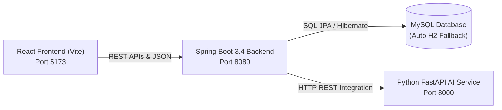

# InterviewPrep AI — AI-Powered Interview Preparation System

> **College Minor Project**  
> **Team:** COSMIC CODER'S  
> **Project Title:** AI-Powered Interview Preparation System (InterviewPrep AI)

InterviewPrep AI is a modern, end-to-end interview preparation platform that combines an intuitive React SaaS dashboard, a robust Spring Boot microservice backend, and an intelligent Python FastAPI AI evaluation service to provide real-time mock interviews, domain question generation, and comprehensive scoring feedback.

---

## 🏛 System Architecture



1. **Frontend (`frontend/`)**: React 18 with Vite, Tailwind CSS, Lucide icons, React Router, responsive SaaS dashboard layout, live state management with resilient offline fallbacks.
2. **Backend (`backend/`)**: Java 21, Spring Boot 3.4.0, Spring Data JPA, Hibernate, MySQL Connector, dynamic embedded H2 fallback for zero-crash evaluation, DTO-based REST APIs.
3. **AI Microservice (`ai-service/`)**: Python FastAPI microservice providing domain-tailored technical questions, heuristic answer scoring, strengths/weaknesses extraction, and personalized improvement guidance.

---

## 🚀 How to Run the Complete Project

Follow these simple steps to run all three services concurrently on your local machine:

### 1. Start the Python AI Microservice (Port 8000)
```bash
cd ai-service
python -m uvicorn main:app --host 127.0.0.1 --port 8000
```
- Health Check: `http://localhost:8000/health`

### 2. Start the Spring Boot Backend (Port 8080)
```bash
cd backend
.\mvnw.cmd spring-boot:run
```
*(On macOS / Linux: `./mvnw spring-boot:run`)*  
- Health Check: `http://localhost:8080/api/health`
- Note: Spring Boot automatically connects to MySQL if running; if MySQL is not started, it automatically falls back to an embedded in-memory database so the system never crashes!

### 3. Start the React Frontend (Port 5173)
```bash
cd frontend
npm run dev
```
- Open in your browser: **`http://localhost:5173`**

---

## 🔄 End-to-End User Flow

1. **Dashboard (`/`)**:
   - Displays live KPI counters: Total Interviews, Average Score, Strongest Skill, and Current Streak.
   - Interactive weekly performance SVG chart with score tooltips.
   - Quick Links to DSA practice, interview tips, lectures, and mock tests.
   - Recent activity list with real-time score badges.
2. **Configure Interview (`/start-interview` or Dashboard Quick Form)**:
   - Select target job role (e.g. *Software Developer*, *Frontend Developer*, *Java Backend*, *Full Stack*).
   - Customize skills focus tags (e.g. *Java, Spring Boot, SQL*).
   - Choose experience level (*Fresher*, *1-2 Years*, *3-5 Years*, *5+ Years*) and difficulty (*Easy*, *Medium*, *Hard*).
   - Backend calls the AI service to generate role-tailored technical questions.
3. **Interview Practice Session (`/interview-session`)**:
   - Interactive session timer and progress bar.
   - Formulate candidate answers with voice note simulation option.
   - Question hints and topic criteria review.
   - Real-time optimistic answer auto-syncing with Spring Boot backend.
4. **AI Evaluation & Scorecard (`/evaluation`)**:
   - Submit interview to trigger automated AI evaluation.
   - Visual radial overall score and performance grade (e.g. *Strong Hire*, *Needs Practice*).
   - Category breakdowns: Technical Accuracy, Communication, Problem Solving, and Depth.
   - Personalized strengths, areas for improvement, and recommended learning resources.
   - Question-by-question breakdown with candidate answers and model answers.
5. **Interview History & Analytics (`/history`, `/performance`)**:
   - Chronological recorded sessions with score badges, search, and difficulty filtering.
   - View any previous interview report with a single click.
   - Technical topic mastery progress bars and placement readiness benchmarks.

---

## 📡 REST API Reference

| Method | Endpoint | Description |
| :--- | :--- | :--- |
| `GET` | `/api/health` | Backend service health and status |
| `GET` | `/api/dashboard` | KPI statistics, weekly chart points, and recent activity |
| `GET` | `/api/performance` | Technical competency benchmarks and topic mastery |
| `POST` | `/api/interviews` | Create an interview session and fetch AI questions |
| `GET` | `/api/interviews/{id}` | Retrieve specific interview with questions and answers |
| `POST` | `/api/interviews/{id}/answers` | Save/update a candidate's answer |
| `POST` | `/api/interviews/{id}/complete` | Conclude session and generate AI evaluation report |
| `GET` | `/api/interviews/{id}/results` | Retrieve evaluation report and question reviews |
| `GET` | `/api/interviews/history` | Chronological list of previous mock interviews |

---

## 🛠 Technology Stack

- **Frontend:** React 18, Vite, Tailwind CSS, Lucide Icons, React Router v6
- **Backend:** Java 21 LTS, Spring Boot 3.4.0, Spring Data JPA, Hibernate, MySQL Driver, H2 Database
- **AI Service:** Python 3.14, FastAPI, Uvicorn, Pydantic, HTTPX
- **Build Tools:** Maven 3.9 (portable wrapper included), npm
